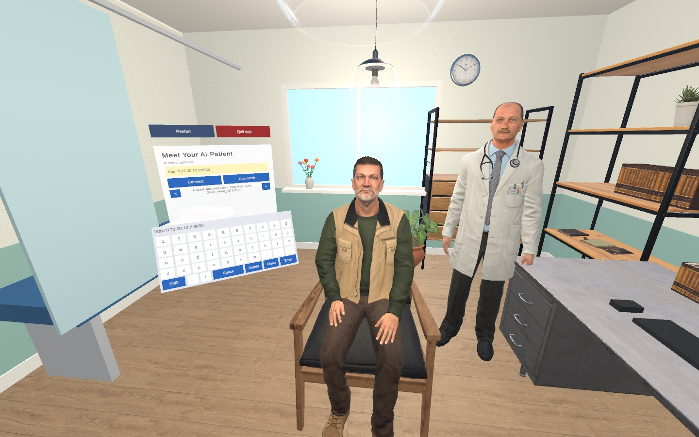
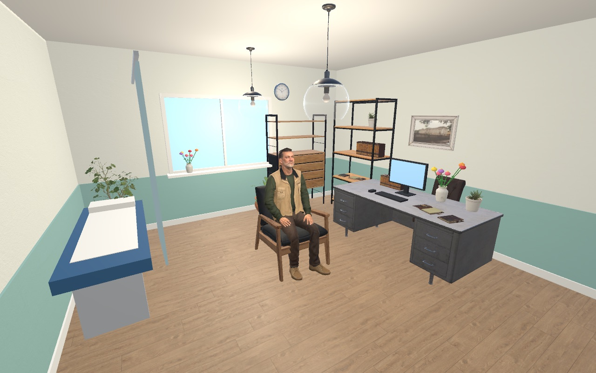
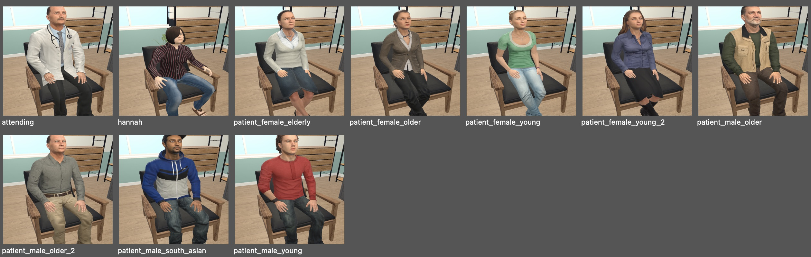

# 🩺 Meet Your AI Patient – VR History Taking for Apple Vision Pro

Meet Your AI Patient is a fully immersive VR app for Apple Vision Pro where medical students practise history taking (anamnesis) with an AI patient. The student sits in a GP consultation room across from a 3D patient, asks questions by voice or keyboard, and hears and reads the patient's answers. When the conversation ends, a doctor steps in with feedback: what the student covered, what they missed, and the transcript lines behind each item.

Built with Unity during the "Meet Your AI Patient" hackathon challenge (OTH Amberg-Weiden). This repository is my own Unity version of the headset app, kept separate from the team project.

## 🛠 How It Works
- **Consultation room:** A GP office with a desk, monitor, plants, flowers and shelves, lit with soft shadows. The patient sits in an armchair 1.35 m in front of the student.
- **Patients:** 8 seated characters (Microsoft Rocketbox) with idle and talking animations, lip sync from the voice, blinking and eye contact. Each case brings its own patient, or the student picks one with `<` `>`.
- **Talking:** On-device speech recognition (Apple Speech), the app's own VR keyboard, or quick-question buttons. Answers always appear as subtitles; the voice plays when the server sends one.
- **Look and pinch:** All buttons work with gaze and pinch; a pinch just beside a button still counts.
- **Feedback:** At the end, the attending doctor appears standing by the desk while the checklist result is shown: score, covered items with the student's own words, missed items with a suggested question.
- **Restart / Quit:** Restart starts over in one tap and puts the student back in front of the patient; Quit closes the app.

## 💻 Tech Stack
- **Engine:** Unity 6 (6000.6.9f1), Apple visionOS XR Plugin 3.3.1, full immersion (Metal rendering)
- **Hardware Target:** Apple Vision Pro
- **Language:** C#, Objective-C++ (Apple Speech bridge), Python (asset tools)
- **AI backend:** The team's AI patient server (FastAPI, HTTP on port 8000; not part of this repo). **Use mock** runs the app without it.
- **Assets:** Microsoft Rocketbox characters and animations (MIT), Poly Haven models and textures (CC0), downloaded by scripts

## ⚙ Setup Instructions
1-Install Unity 6000.6.9f1 with visionOS Build Support, and Xcode.
2-Download the art (about 550 MB, not stored in git): `python3 tools/fetch_room_assets.py` and `python3 tools/fetch_rocketbox.py`
3-Open the `MedicalVR` folder in Unity and run **MedicalVR > Configure project** (imports the room and the characters, builds the scene).
4-Turn on Developer Mode on the Vision Pro, put it on the same Wi-Fi as the Mac, then run `TEAM=<your Apple team id> BUNDLE=<your app id> tools/device.sh` (builds, signs, installs and launches).
5-Start the AI patient server on the Mac and tap **Connect** (the app tries the Mac's addresses by itself), or tap **Use mock**.

## 📸 Screenshots
### Consultation room

### Patients

## 🙏 Credits
- 3D characters and animations: [Microsoft Rocketbox](https://github.com/microsoft/Microsoft-Rocketbox) (MIT)
- Room models, textures and lighting: [Poly Haven](https://polyhaven.com) (CC0)
- Avatar controller scripts (`MedicalVR/Assets/Avatar/Scripts`): rafoolin, from the team project
- Font: Liberation Sans (SIL Open Font License)
